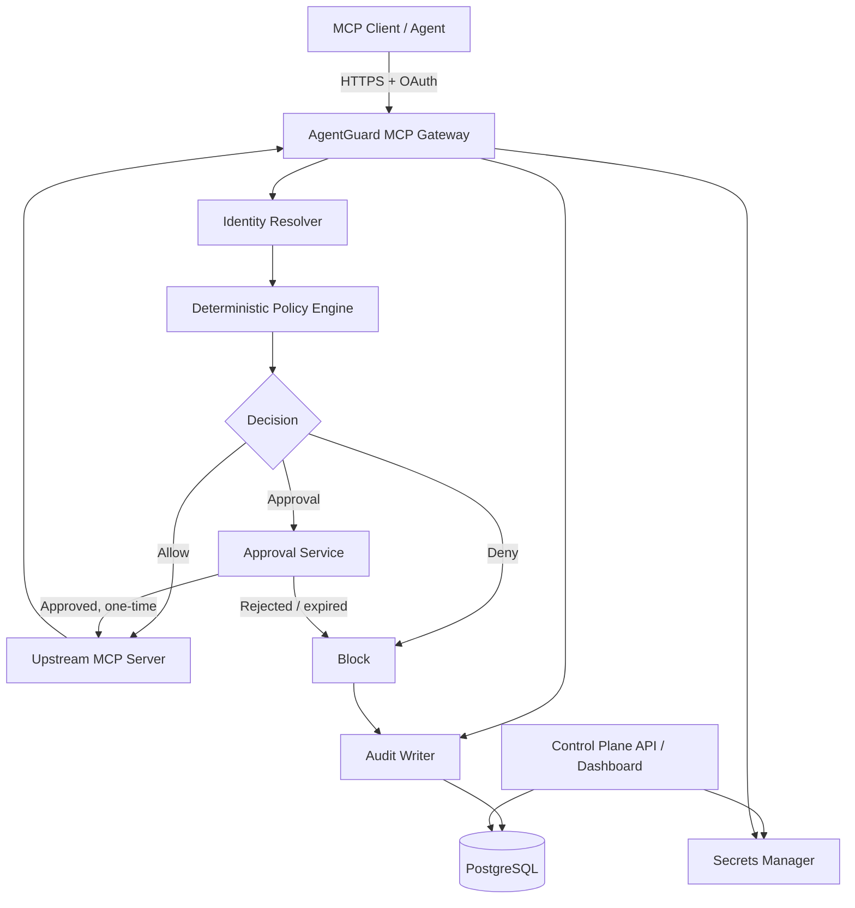

# AgentGuard — Architecture Design

**Version:** 0.1 | **Date:** 2026-11-21

## 1. Architecture principles

1. Modular monolith; no microservices for MVP.
2. Gateway is the policy enforcement point (PEP).
3. Policy evaluator is deterministic and independent of LLMs.
4. Control plane and data plane are logically separated, even if deployed in one codebase.
5. PostgreSQL is the source of truth.
6. Redis is optional and never the sole store for approvals or audit evidence.
7. Upstream credentials are independent from inbound client credentials.
8. Default deny for protected operations.
9. No untrusted tool metadata or model output can grant permissions.
10. Network egress is restricted to administrator-approved upstream destinations.

## 2. Logical components

### Control plane
- Authentication and tenant context.
- Tenant/user administration.
- Agent registry.
- Upstream registry and secret references.
- Policy CRUD and versioning.
- Approval administration.
- Audit query API.
- Usage metering (later).

### Data plane
- MCP Streamable HTTP endpoint.
- Protocol handler.
- Client authentication.
- Agent identity resolver.
- Upstream MCP client/connection manager.
- Tool discovery filter.
- Policy decision point (PDP).
- Policy enforcement point (PEP).
- Approval coordinator.
- Audit event writer.

### Infrastructure
- PostgreSQL.
- Redis (optional).
- Managed secrets/KMS.
- OpenTelemetry.
- Reverse proxy / load balancer.
- Object storage only if later required for exports.

## 3. Request flow

For every `tools/call`:
1. Receive MCP request over HTTPS.
2. Validate request size, content type, protocol version and JSON-RPC envelope.
3. Authenticate caller and resolve tenant/agent from verified claims.
4. Resolve configured upstream by route binding; never accept arbitrary upstream URL from the request body.
5. Resolve tool name and canonical argument representation.
6. Evaluate active policy version.
7. If deny: return safe MCP/JSON-RPC error and write audit event.
8. If approval required: create one-time approval record bound to argument digest and policy version; do not call upstream.
9. If allow: fetch upstream credential from secret manager, create an upstream request using that credential, and invoke tool.
10. Record outcome and latency.
11. Return upstream result after applying response size limits and safe error handling.

## 4. Protocol scope

- Transport: Streamable HTTP only.
- Protocol revision: pin `2026-07-28` unless interoperability testing demonstrates SDK support gaps; any deviation requires an ADR.
- MVP methods: initialize, notifications/initialized, ping, tools/list, tools/call, and required protocol metadata/health behavior.
- Other MCP methods are rejected or not advertised until explicitly implemented and tested.
- Do not assume MCP sessions are authentication. Authentication is verified on every HTTP request.
- Do not treat tool annotations/descriptions as trusted policy.
- Do not support STDIO in MVP.

The protocol changed in 2026-07-28. Implement against the official spec and pinned SDK, not hand-written assumptions.

## 5. Authorization design

### Inbound identity
Production authorization must follow the MCP HTTP authorization requirements for the pinned spec:
- OAuth 2.1 security practices.
- Protected Resource Metadata (RFC 9728).
- Authorization Server Metadata (RFC 8414) or OIDC discovery.
- Resource indicators / audience binding (RFC 8707).
- Validate issuer, signature, expiry, not-before, audience, scopes and tenant/agent binding.
- Reject invalid, expired, wrong-audience or revoked credentials.
- Never place access tokens in URLs or logs.

For local tests, use deterministic test tokens. A development-only service-token profile may be used only if explicitly enabled and cannot be enabled in production.

### Upstream identity
- Use a distinct credential for each upstream connection.
- Store secret reference, not secret material in ordinary DB columns.
- Do not forward inbound Authorization headers.
- Do not accept arbitrary client-provided upstream tokens.
- Scope upstream credentials to minimum required tools/resources.
- Rotate and revoke credentials.

## 6. Policy engine

Use a small deterministic policy model for MVP. A custom evaluator is acceptable if:
- Policy schema is versioned.
- Evaluation is pure and deterministic.
- Rule precedence is explicit.
- Invalid or ambiguous policy denies.
- Tests cover all operators and edge cases.

OPA is a valid later option. Do not add OPA as a runtime dependency until policy complexity justifies it. If adopted, deploy it close to the PEP and treat it as a PDP. See https://www.openpolicyagent.org/docs/deploy.

### Initial policy input
- tenant_id
- agent_id
- environment
- upstream_id
- tool_name
- normalized arguments (only fields needed for policy)
- request timestamp
- authenticated principal/scopes

### Initial decision
- `allow`
- `deny`
- `require_approval`

Decision includes policy ID, version, reason code and safe explanation.

## 7. Approval consistency

Approval must be persisted in PostgreSQL. Redis may publish notifications but cannot be authoritative.

Bind approval to:
- tenant ID
- agent ID
- upstream ID
- tool name
- canonical arguments SHA-256
- policy ID/version
- expiry
- one-time nonce

Execution must atomically transition approval from approved to executing/executed using a conditional update or row lock. Concurrent replay attempts must result in at most one upstream invocation. If the gateway crashes after upstream execution but before recording outcome, mark the result as uncertain; do not automatically retry a non-idempotent operation.

## 8. Audit architecture

Append-only `audit_events` table:
- application role has INSERT and SELECT, no UPDATE/DELETE.
- administrative retention/deletion runs through a separate controlled process.
- chain hash or equivalent tamper-evidence can be added for MVP.
- record hash must include previous event hash within a tenant stream, with concurrency handled transactionally.
- never claim cryptographic immutability; database administrators remain privileged.

Store argument digest by default, not raw arguments. Optional redacted argument snapshot must be opt-in per tenant and field allowlist.

## 9. Data flow diagram



## 10. Deployment

MVP cloud deployment:
- One application image, separate web/API and gateway process commands if required.
- Managed PostgreSQL with TLS and automated backups.
- Redis optional.
- Managed KMS/secrets manager.
- HTTPS load balancer.
- Non-root container.
- Read-only filesystem where feasible.
- Resource limits and health checks.
- Separate dev/staging/prod environments.
- No Kubernetes requirement.

## 11. Suggested repository layout

```text
agentguard/
  app/
    api/
      routes/
    gateway/
      protocol/
      upstream/
      enforcement/
    auth/
    agents/
    policies/
    approvals/
    audit/
    tenants/
    secrets/
    common/
  migrations/
  tests/
    unit/
    integration/
    security/
    protocol/
    e2e/
  docs/
  scripts/
  Dockerfile
  compose.yaml
  pyproject.toml
  README.md
```

## 12. Reuse from existing projects

Potential sources:
- OpenShield-luna: FastAPI lifecycle, PostgreSQL pool patterns, gateway transport patterns, event handling, policy execution, non-root container and CI conventions.
- AMASDO: usage/billing aggregation, provider-independent patterns, Redis queue conventions and telemetry concepts.

Reuse only after code review, dependency/license review, isolation review and tests. Do not import either project as a runtime dependency. Do not copy security assumptions from a different product domain without revalidation.
